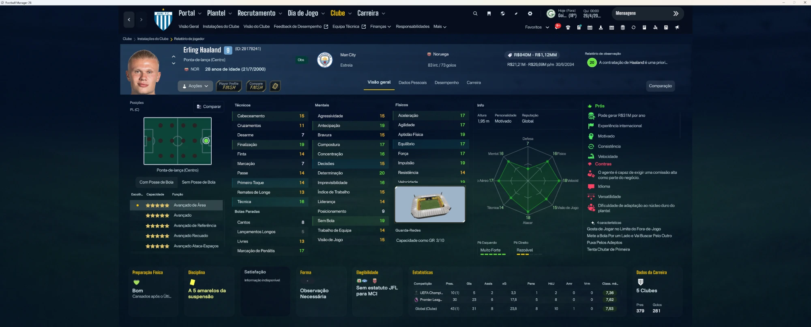

# FM ActionLink: Integration Spec

Technical reference for developers and AI coding assistants. It describes exactly what the
plugin does, the configuration file, the event protocol, the C# API and the requirements an
external app must meet. Plain-language guides for players and non-technical creators:
`LEIA-ME.txt` (Português) and `README.txt` (English).



*Example of the result: buttons after "Actions" (custom look in this picture; by default
they copy the game's style) and a 3D stadium rendered by an external app, glued over an
embedded panel in the Physical column.*

Plugin version: **1.0.0**. Scope: **player profile screen only**.

---

## 0. For AI assistants: how to use this document

- Sections 3 (config), 4 (events) and 5 (app requirements) are normative. Words **MUST**,
  **SHOULD**, **MAY** follow RFC 2119.
- JSON Schemas in 3.4 and 4.5 are authoritative for shapes; tables explain meaning.
- Section 9 is a checklist to verify an implementation. Section 10 has a prompt a user can
  paste to start a task.
- Do not invent events, fields or config keys that are not listed here. The plugin ignores
  unknown config keys and never sends anything not listed in section 4.
- The plugin never renders external content. Any window, preview or 3D view is created and
  positioned by the external app.

---

## 1. Architecture

```
+-------------------------- Football Manager 26 (fm.exe, Unity 6000.0.52 IL2CPP) --------------------------+
|  BepInEx 6 (be.755+)                                                                                     |
|   FMActionLink.dll                                                                                  |
|     - reads FMActionLink.json (hot reload) and the C# registry                                          |
|     - injects buttons after #FrameActions, and empty panels between two labels                           |
|     - tracks mouse, keyboard, visibility and screen position                                             |
+-----------------------------------+----------------------------------------------------------------------+
                                    | HTTP POST, JSON, one at a time, in order
                                    v
                    app.eventsUrl   (for example http://127.0.0.1:8767/fm-events)
+----------------------------------------------------------------------------------------------------------+
|  External app (any language)                                                                             |
|     - answers 2xx immediately                                                                            |
|     - opens/moves/hides its own borderless, topmost, non-activating windows at the given screen pixels   |
+----------------------------------------------------------------------------------------------------------+
```

Actions that need no app: `openUrl` (default browser) and `runProgram` (starts a process).

### 1.1 Files

```
BepInEx\plugins\FMActionLink\
    FMActionLink.dll     plugin
    FMActionLink.xml     XML docs for the C# API
    FMActionLink.json        configuration (hot reloaded)
    icons\*.png               icons referenced by the config
```

Log: `<game>\BepInEx\LogOutput.log`, every line prefixed with `[ActionLink]`.

### 1.2 Runtime facts

| Item | Value |
|---|---|
| Game | Football Manager 26, Windows (Steam, Epic, Xbox/Game Pass) |
| Engine | Unity 6000.0.52, IL2CPP, UI Toolkit |
| Loader | BepInEx 6.0.0 be.755 or newer (IL2CPP, CoreCLR .NET 6) |
| Plugin GUID | `fm.actionlink` |
| Target framework | `net6.0` |
| Game display mode | windowed or borderless; exclusive full screen hides external windows |

---

## 2. Behaviour on screen

### 2.1 Buttons

- Container: a `VisualElement` named `actionlink-group-500-actionlink` (flex row) inside the
  **shared row** (below), which sits right after the first child of the element named
  `#FrameActions` (the "Actions" dropdown). `#FrameActions` is switched to `flex-direction: row`.
- **Shared row** (for any plugin that adds buttons next to "Actions"): one `VisualElement` named
  `actionlink-row`, created by whichever plugin gets there first, right after "Actions". Each
  plugin puts its buttons in a group of its own inside it, named `actionlink-group-NNN-<name>`,
  and after adding its group sorts the row's children by name (ordinal). NNN sets the order no
  matter which plugin loads first: `000` is reserved for FM ActionLink - FMSH (always first),
  `500` is this plugin; pick any other number. When removing its group, a plugin also removes
  the row if it is left empty. The names are the whole agreement: plugins never reference each
  other (reference code: `src/SharedRow.cs`).
- Each button: a UI Toolkit `Button` named `actionlink-<id>`. Its class list is cleared and replaced
  by the classes of the "Actions" element; its label (a `Label`) gets the classes of the first
  text element inside "Actions". Result: the game's own style, following any skin.
- Height is synced every frame to the "Actions" element. Buttons without `label` are square
  (width = height, no horizontal padding).
- Icon: 16x16 `VisualElement` with the PNG/JPG as background (stretched), 6 px before the label.
- Order: registration order (config order for JSON buttons; JSON and C# buttons share one list,
  JSON ones are re-added after each reload).

### 2.2 Window buttons: state machine

States: `Closed`, `Hover` (open, follows the mouse), `Pinned` (open, stays).

| From | Trigger | To | Event (default handler) |
|---|---|---|---|
| Closed | mouse rests on button for `hoverDelayMs` and `openOnHover` is true | Hover | `window.open` mode `hover` |
| Closed | click or hotkey | Pinned | `window.open` mode `pinned` (may start the app, see 4.3) |
| Hover | mouse leaves the button | Closed | `window.close` reason `mouseLeft` |
| Hover | click or hotkey | Pinned | `window.pin` |
| Pinned | left click anywhere in the game outside the button | Closed | `window.close` reason `clickOutside` |
| Pinned | Esc | Closed | `window.close` reason `escape` |
| Pinned | click or hotkey on the same button | Closed | `window.close` reason `clickedAgain` |
| Hover/Pinned | button hidden, screen left, or buttons rebuilt | Closed | `window.close` reason `screenChanged` |

Clicks inside the external app's own window do not reach the game, so they never count as
`clickOutside`. Buttons are independent: pinning one does not close another, but clicking a
second button counts as a click outside the first.

### 2.3 Embedded panels

Placement algorithm, run every 0.5 s for panels not yet placed:

1. Find text elements whose trimmed text equals one of `afterLabel` (A) and one of
   `beforeLabel` (B), exact match, case-sensitive.
2. For each pair, find the closest common ancestor C within 8 levels, and the children of C on
   the path to A and to B.
3. Accept only if C's resolved `flex-direction` is `column` and B's branch comes after A's
   branch. This rejects labels that sit side by side (for example the goalkeeper profile).
4. Insert the panel (`VisualElement` named `actionlink-panel-<id>`) right before B's branch.

Panel style: `flex-grow: 1; flex-shrink: 1; flex-basis: 0; min-height: 0; overflow: hidden;
align-self: stretch`, margins 8/10/8/4 (top/right/bottom/left), translucent background and
1 px border with 4 px radius, optional centered `placeholderText`. It only takes the column's
**spare** space and never shrinks the game's own rows.

Tracking, every 50 ms: the panel is **shown** when attached, displayed (no ancestor with
`display: none`, `visibility: hidden` or `opacity < 0.05`), the game is not minimized, its
layout height is at least `minHeight` (UI units) and its width is at least 8 px. Otherwise it is
**hidden**. `panel.show` is sent on becoming shown, when the screen rect changes, when the
player ID changes, and every 2 s while unchanged (keepalive, lets a restarted app recover).
`panel.hide` is sent once on becoming hidden.

### 2.4 Player ID

Two sources, in this order:

1. **The header photo's picture key.** Game pictures (`SI.UI.Image`) keep the key they were
   loaded with in `m_imageAddressableID`; the header photo is requested as `person/{id}/...`
   (players without a photo get `person_default`, with no ID). Climbing from the "Actions" button
   level by level, the FIRST person picture decides: `person_<id>` gives the ID;
   `person_default` means no photo and the search stops there (climbing further would pick
   another person on the screen).
2. **The header text** `(ID: 12345678)`, only shown when that option is on: regex
   `\bID\s*[:：]?\s*(\d{4,})`, first in the screen's own UI document, then in every other one.

The picture keys found near "Actions" are written to the log once per distinct set. If both
sources fail, `playerId` is omitted and the first failure of the session writes up to 15
candidate texts to the log.

### 2.5 Screen coordinates

`rect`/`anchor` = element `worldBound` (UI units) mapped to the Unity screen with
`RuntimePanelUtils.ScreenToPanel` at (0,0) and (Screen.width, Screen.height), then offset by
`ClientToScreen` of the game's main window. Output: **physical pixels on the Windows virtual
desktop**, origin top-left of the primary monitor. Values can be negative on multi-monitor
setups.

### 2.6 Hotkeys

Format `mod+mod+key`, case-insensitive. Modifiers: `ctrl` (or `control`), `shift`, `alt`. Key:
any Unity Input System `Key` name (`a`..`z`, `f1`..`f12`, `space`, `enter`, `digit1` or `1`,
`numpad1`, ...). Modifier state must match exactly (`ctrl+p` does not fire on
`ctrl+shift+p`). Active only while the button is shown and no `TextField` has focus. A hotkey
behaves exactly like a click.

---

## 3. Configuration file: `FMActionLink.json`

### 3.1 Parsing and reload

- Location: next to the DLL. JSON with `//` and `/* */` comments and trailing commas allowed.
  Keys are case-insensitive. Unknown keys are ignored.
- Polled every 2 s by last-write time. On a parse error the previous configuration stays
  active and an error is logged. Deleting the file removes all JSON-defined items (app settings
  stay).
- JSON-defined items are tracked separately: a reload replaces them and leaves C#-registered
  items untouched.
- Relative paths (`icon`, `runProgram.path`) resolve against the plugin folder.
  `%ENV_VARS%` are expanded in `runProgram.path` and `app.startIfClosed`.
- `{playerId}` is the only placeholder, replaced in `openUrl.url`, `runProgram.arguments`. If
  the template contains it and no ID was found, the action is skipped and a warning is logged.

### 3.2 Keys

| Path | Type | Default | Meaning |
|---|---|---|---|
| `app.eventsUrl` | string (URL) | `""` | Endpoint receiving events. Empty: events are not sent (warning). |
| `app.startIfClosed` | string (path) | `""` | Executable started when a click finds the app unreachable. |
| `app.startArguments` | string | `""` | Arguments for `startIfClosed`. |
| `app.startTimeoutSeconds` | int | `45` | How long to retry after starting the app. |
| `playerProfile.buttons[]` | array | `[]` | Buttons, in display order. |
| `playerProfile.buttons[].id` | string | required | Unique id (duplicates: the last one wins). Sent as `buttonId`. |
| `playerProfile.buttons[].label` | string | none | Text. Absent: square icon button. |
| `playerProfile.buttons[].icon` | string | none | PNG or JPG. Recommended 64x64 white on transparent. |
| `playerProfile.buttons[].tooltip` | string | none | Native tooltip. |
| `playerProfile.buttons[].hotkey` | string | none | See 2.6. |
| `playerProfile.buttons[].enabled` | bool | `true` | `false` skips the button. |
| `playerProfile.buttons[].action.type` | enum | required | `openUrl`, `runProgram`, `sendToApp`, `window`. |
| `...action.url` | string | | `openUrl`: http or https URL. Other schemes are refused. |
| `...action.path` | string | | `runProgram`: executable (started with shell execute). |
| `...action.arguments` | string | `""` | `runProgram`: argument string. |
| `...action.openOnHover` | bool | `false` | `window`: open on hover (see 2.2). |
| `...action.hoverDelayMs` | int | `250` | `window`: hover delay. |
| `playerProfile.embeddedPanels[]` | array | `[]` | Panels. |
| `playerProfile.embeddedPanels[].id` | string | required | Unique id. Sent as `panelId`. |
| `...afterLabel` | string or string[] | required | Label texts above the panel (any language listed). |
| `...beforeLabel` | string or string[] | required | Label texts below the panel, same column. |
| `...minHeight` | int | `110` | Minimum height in UI units for the panel to count as shown. |
| `...placeholderText` | string | none | Text inside the panel until covered. |
| `...enabled` | bool | `true` | `false` skips the panel. |
| `debug.logScreenTree` | bool | `false` | Logs the "Actions" subtree on mount and each panel's column on placement. |

### 3.3 Action types

| `type` | Needs app | Effect |
|---|---|---|
| `openUrl` | no | Opened by the Windows shell (`explorer.exe "<url>"`) after placeholder substitution. |
| `runProgram` | no | Without arguments: opened by the Windows shell (`explorer.exe`). With arguments: started by WMI `Win32_Process.Create`, working dir = exe folder. Missing file: warning. |
| `sendToApp` | yes | Sends `button.click`; may start the app (4.3). |
| `window` | yes (unless handled in C#) | Window button, see 2.2 and 4.2. |

Every program the plugin starts (actions and `startIfClosed`) is started **outside the game's
process group**. Started directly by `fm.exe` it would become a child of the game, and Steam
would keep showing the game as running after it closes, until that program closed too.

### 3.4 JSON Schema

```json
{
  "$schema": "https://json-schema.org/draft/2020-12/schema",
  "title": "FMActionLink.json",
  "type": "object",
  "properties": {
    "app": {
      "type": "object",
      "properties": {
        "eventsUrl": { "type": "string", "format": "uri" },
        "startIfClosed": { "type": "string" },
        "startArguments": { "type": "string" },
        "startTimeoutSeconds": { "type": "integer", "minimum": 1 }
      }
    },
    "playerProfile": {
      "type": "object",
      "properties": {
        "buttons": { "type": "array", "items": { "$ref": "#/$defs/button" } },
        "embeddedPanels": { "type": "array", "items": { "$ref": "#/$defs/panel" } }
      }
    },
    "debug": { "type": "object", "properties": { "logScreenTree": { "type": "boolean" } } }
  },
  "$defs": {
    "labels": { "oneOf": [ { "type": "string" }, { "type": "array", "items": { "type": "string" }, "minItems": 1 } ] },
    "button": {
      "type": "object",
      "required": ["id", "action"],
      "properties": {
        "id": { "type": "string", "minLength": 1 },
        "label": { "type": "string" },
        "icon": { "type": "string" },
        "tooltip": { "type": "string" },
        "hotkey": { "type": "string", "pattern": "^((ctrl|control|shift|alt)\\+)*[A-Za-z0-9]+$" },
        "enabled": { "type": "boolean" },
        "action": {
          "oneOf": [
            { "type": "object", "required": ["type", "url"],
              "properties": { "type": { "const": "openUrl" }, "url": { "type": "string", "pattern": "^https?://" } } },
            { "type": "object", "required": ["type", "path"],
              "properties": { "type": { "const": "runProgram" }, "path": { "type": "string" }, "arguments": { "type": "string" } } },
            { "type": "object", "required": ["type"],
              "properties": { "type": { "const": "sendToApp" } } },
            { "type": "object", "required": ["type"],
              "properties": { "type": { "const": "window" }, "openOnHover": { "type": "boolean" },
                              "hoverDelayMs": { "type": "integer", "minimum": 0 } } }
          ]
        }
      }
    },
    "panel": {
      "type": "object",
      "required": ["id", "afterLabel", "beforeLabel"],
      "properties": {
        "id": { "type": "string", "minLength": 1 },
        "afterLabel": { "$ref": "#/$defs/labels" },
        "beforeLabel": { "$ref": "#/$defs/labels" },
        "minHeight": { "type": "integer", "minimum": 0 },
        "placeholderText": { "type": "string" },
        "enabled": { "type": "boolean" }
      }
    }
  }
}
```

### 3.5 Full example

```jsonc
{
  "app": {
    "eventsUrl": "http://127.0.0.1:8767/fm-events",
    "startIfClosed": "%LOCALAPPDATA%\\Programs\\MyApp\\MyApp.exe",
    "startTimeoutSeconds": 45
  },
  "playerProfile": {
    "buttons": [
      { "id": "search-web", "label": "Search", "action": { "type": "openUrl", "url": "https://www.google.com/search?q=FM26+player+{playerId}" } },
      { "id": "open-in-app", "label": "Open in app", "hotkey": "ctrl+shift+o", "action": { "type": "sendToApp" } },
      { "id": "quick-preview", "icon": "icons/radar.png", "tooltip": "Preview", "action": { "type": "window", "openOnHover": true, "hoverDelayMs": 250 } },
      { "id": "model-3d", "icon": "icons/cube.png", "tooltip": "3D", "action": { "type": "window", "openOnHover": false } }
    ],
    "embeddedPanels": [
      { "id": "embedded-3d", "afterLabel": ["Físicos", "Physical"], "beforeLabel": ["Guarda-Redes", "Goleiro", "Goalkeeping", "Goalkeeper"], "minHeight": 110 }
    ]
  },
  "debug": { "logScreenTree": false }
}
```

The panel position above (Physical column, above Goalkeeping) is a **test suggestion only**:
it exists for outfield players and not for goalkeepers.

---

## 4. Event protocol

### 4.1 Transport

| Aspect | Behaviour |
|---|---|
| Method / URL | `POST app.eventsUrl` |
| Body | UTF-8 JSON object, `Content-Type: application/json`, camelCase, null fields omitted |
| Ordering | One sender thread, FIFO queue: the next request starts only after the previous one completed |
| Timeout | 3 s per request |
| Success | Any 2xx. Nothing in the response body is read |
| Non-2xx | Logged (`the app answered <code>`), not retried |
| Unreachable (connection error or timeout) | Dropped; warning at most once per minute. Exception: 4.3 |
| Delivery | At most once, no acknowledgement semantics beyond the status code |

Consequence: a slow handler delays every later event (a `window.close` stuck behind a slow
`window.open`). The app **MUST** answer before doing any work.

### 4.2 Events

Common fields on every event:

| Field | Type | Meaning |
|---|---|---|
| `event` | string | Event name (below). |
| `screen` | string | Screen name. Currently always `playerProfile`. |
| `gamePid` | int | Process id of `fm.exe`. |

| `event` | Sent when | Extra fields |
|---|---|---|
| `button.click` | Click or hotkey on a `sendToApp` button | `buttonId`, `playerId`? |
| `window.open` | See 2.2 | `buttonId`, `playerId`?, `mode` (`hover`, `pinned`), `anchor`, `cursorX`, `cursorY` |
| `window.pin` | Hover window pinned by a click | same as `window.open`, `mode` = `pinned` |
| `window.close` | See 2.2 | `buttonId`, `playerId`?, `mode` (state before closing), `reason` (`mouseLeft`, `clickOutside`, `escape`, `clickedAgain`, `screenChanged`) |
| `panel.show` | See 2.3 | `panelId`, `playerId`?, `rect` |
| `panel.hide` | See 2.3 | `panelId` |

`?` = omitted when the player ID was not found. `anchor` is the button's rect, `rect` the
panel's rect, both `{x, y, width, height}` in physical virtual-desktop pixels (2.5).
`cursorX`/`cursorY`: mouse position in the same space at the time of the event.

Examples:

```json
{"event":"button.click","buttonId":"open-in-app","screen":"playerProfile","playerId":29179241,"gamePid":4876}
{"event":"window.open","buttonId":"quick-preview","screen":"playerProfile","playerId":29179241,"mode":"hover","anchor":{"x":1180,"y":262,"width":38,"height":38},"cursorX":1195,"cursorY":280,"gamePid":4876}
{"event":"window.pin","buttonId":"quick-preview","screen":"playerProfile","playerId":29179241,"mode":"pinned","anchor":{"x":1180,"y":262,"width":38,"height":38},"cursorX":1196,"cursorY":281,"gamePid":4876}
{"event":"window.close","buttonId":"quick-preview","screen":"playerProfile","playerId":29179241,"mode":"pinned","reason":"clickOutside","gamePid":4876}
{"event":"panel.show","panelId":"embedded-3d","screen":"playerProfile","playerId":29179241,"rect":{"x":1283,"y":820,"width":342,"height":141},"gamePid":4876}
{"event":"panel.hide","panelId":"embedded-3d","screen":"playerProfile","gamePid":4876}
```

### 4.3 Starting the app (`startIfClosed`)

Applies only to `button.click` and to `window.open` with `mode: "pinned"` (user clicks), and
only when `app.startIfClosed` is set.

1. Before queuing a click, the plugin calls `AllowSetForegroundWindow(ASFW_ANY)`, so the app
   may bring itself to the front.
2. If the POST is unreachable: start the executable the same way as `runProgram` (3.3).
3. Every 500 ms, up to `startTimeoutSeconds`: drain the queue keeping only the most recent
   click (other queued events are **discarded**), call `AllowSetForegroundWindow` again, and
   POST it. Stop at the first reachable answer.

The app therefore **MUST** start its HTTP listener early, and **SHOULD** treat the first
`button.click` after launch as the reason it was started.

### 4.4 Timing summary

| What | Interval |
|---|---|
| Config file check | 2 s |
| Screen scan (mount buttons, place panels, refresh panel player ID) | 0.5 s |
| Panel position check | 50 ms |
| `panel.show` keepalive | 2 s |
| Hover delay | `hoverDelayMs`, default 250 ms |
| HTTP timeout | 3 s |
| App start retry | every 500 ms up to `startTimeoutSeconds` |

### 4.5 JSON Schema of an event

```json
{
  "$schema": "https://json-schema.org/draft/2020-12/schema",
  "title": "FM ActionLink event",
  "type": "object",
  "required": ["event", "screen", "gamePid"],
  "properties": {
    "event": { "enum": ["button.click", "window.open", "window.pin", "window.close", "panel.show", "panel.hide"] },
    "screen": { "const": "playerProfile" },
    "gamePid": { "type": "integer" },
    "buttonId": { "type": "string" },
    "panelId": { "type": "string" },
    "playerId": { "type": "integer" },
    "mode": { "enum": ["hover", "pinned"] },
    "reason": { "enum": ["mouseLeft", "clickOutside", "escape", "clickedAgain", "screenChanged"] },
    "anchor": { "$ref": "#/$defs/rect" },
    "rect": { "$ref": "#/$defs/rect" },
    "cursorX": { "type": "integer" },
    "cursorY": { "type": "integer" }
  },
  "$defs": {
    "rect": {
      "type": "object",
      "required": ["x", "y", "width", "height"],
      "properties": { "x": { "type": "integer" }, "y": { "type": "integer" },
                      "width": { "type": "integer" }, "height": { "type": "integer" } }
    }
  },
  "allOf": [
    { "if": { "properties": { "event": { "const": "button.click" } } }, "then": { "required": ["buttonId"] } },
    { "if": { "properties": { "event": { "enum": ["window.open", "window.pin"] } } }, "then": { "required": ["buttonId", "mode", "anchor", "cursorX", "cursorY"] } },
    { "if": { "properties": { "event": { "const": "window.close" } } }, "then": { "required": ["buttonId", "mode", "reason"] } },
    { "if": { "properties": { "event": { "const": "panel.show" } } }, "then": { "required": ["panelId", "rect"] } },
    { "if": { "properties": { "event": { "const": "panel.hide" } } }, "then": { "required": ["panelId"] } }
  ]
}
```

---

## 5. Requirements for the external app

### 5.1 HTTP endpoint

1. The app **MUST** listen on the host and port of `app.eventsUrl` and accept `POST` on its
   path. Bind to `127.0.0.1` only (never `0.0.0.0`): the endpoint needs no network exposure.
2. It **MUST** answer 2xx (204 recommended) **before** handling the event, then process it
   asynchronously.
3. It **MUST** tolerate unknown `event` values and unknown fields (answer 2xx, ignore).
4. It **SHOULD** handle events idempotently: `panel.show` repeats every 2 s with the same data;
   a `window.close` may arrive for a window that is not open.
5. It **MUST** treat every field as untrusted input: validate types, never pass values to a
   shell, never load URLs built from them without validation.

### 5.2 Windows shown over the game

1. **No activation.** Windows **MUST NOT** take focus when shown or moved. Win32:
   `WS_EX_NOACTIVATE` and/or `ShowWindow(SW_SHOWNOACTIVATE)`, `SetWindowPos(..., SWP_NOACTIVATE)`.
   If the game loses focus it stops receiving mouse and keyboard, which breaks hover and
   Esc handling.
2. **Physical pixels.** The process **MUST** be per-monitor DPI aware v2
   (`SetProcessDpiAwarenessContext(DPI_AWARENESS_CONTEXT_PER_MONITOR_AWARE_V2)`, i.e. `-4`,
   before creating any window, or the equivalent manifest), and position windows with the
   received values unchanged (`SetWindowPos` in physical pixels). Frameworks working in
   logical units (WPF, Electron) **MUST** convert (see 6).
3. **Borderless and topmost** (`WS_POPUP`, `HWND_TOPMOST`).
4. **Visibility follows the game.** A background loop (about every 100 ms) **MUST** hide all
   overlay windows when the foreground window's process id is neither `gamePid` nor the app's
   own process id, and show them again (without activation) when it is.
5. **`window.open`**: create or reuse the window for that `buttonId`, place it relative to
   `anchor` (for example below: `x = anchor.x`, `y = anchor.y + anchor.height + 6`; if it
   does not fit on the monitor's work area, above: `y = anchor.y - 6 - height`), clamp to the
   work area of the monitor containing the anchor.
6. **`window.close`**: close (or hide) that window. It **MUST** also handle a close that
   arrives while the window is still being created (hover out before the page loaded): mark
   it and close it as soon as creation finishes.
7. **`panel.show`**: create the window for that `panelId` the first time, then only move or
   resize it to exactly `rect` when the rect changed. Reload content only if `playerId`
   changed and the content depends on the player.
8. **`panel.hide`**: hide, do not destroy. Content stays loaded for an instant comeback.
9. **`button.click`**: bring the app to the front normally (`SetForegroundWindow` is allowed,
   see 4.3) and show that player.

### 5.3 Content

Any technology the window can render. For 3D, glTF/GLB is the practical choice; the example
uses `<model-viewer>`:

```html
<script type="module" src="https://cdn.jsdelivr.net/npm/@google/model-viewer@4.0.0/dist/model-viewer.min.js"></script>
<model-viewer src="model.glb" camera-controls auto-rotate style="width:100vw;height:100vh"></model-viewer>
```

Keep backgrounds dark (the game UI is dark) and avoid UI inside small panels.

---

## 6. Reference snippets per framework

### 6.1 Python + pywebview (as in `examples/python-app/app.py`)

```python
import ctypes, ctypes.wintypes as wt
ctypes.windll.user32.SetProcessDpiAwarenessContext(ctypes.c_void_p(-4))  # before any window
import webview

win = webview.create_window("overlay", url, x=x, y=y, width=w, height=h,
                            frameless=True, easy_drag=False, on_top=True,
                            resizable=False, focus=False)
# pywebview's x/y are logical: after "shown", fix the position in physical pixels
hwnd = ctypes.windll.user32.FindWindowW(None, "overlay")
ctypes.windll.user32.SetWindowPos(hwnd, wt.HWND(-1), x, y, w, h, 0x10)  # HWND_TOPMOST, SWP_NOACTIVATE
```

Windows must be created after `webview.start()` from worker threads; create the HTTP server
in the `func` passed to `webview.start`.

### 6.2 C# WinForms / WPF host

```csharp
// Program start (or app.manifest <dpiAwareness>PerMonitorV2</dpiAwareness>)
[DllImport("user32.dll")] static extern bool SetProcessDpiAwarenessContext(IntPtr value);
SetProcessDpiAwarenessContext(new IntPtr(-4));

// WinForms overlay form
protected override bool ShowWithoutActivation => true;
protected override CreateParams CreateParams
{
    get
    {
        var cp = base.CreateParams;
        cp.ExStyle |= 0x08000000 /*WS_EX_NOACTIVATE*/ | 0x00000008 /*WS_EX_TOPMOST*/ | 0x00000080 /*WS_EX_TOOLWINDOW*/;
        return cp;
    }
}
// position in physical pixels
SetWindowPos(Handle, new IntPtr(-1), rect.X, rect.Y, rect.Width, rect.Height, 0x0010 /*SWP_NOACTIVATE*/);
```

WPF uses device-independent units: position through the window handle with `SetWindowPos`
(as above) instead of `Left`/`Top`, and set `ShowActivated = false`, `Topmost = true`,
`WindowStyle = None`, `WS_EX_NOACTIVATE` via `WindowInteropHelper`.

HTTP listener: `HttpListener` with the prefix `http://127.0.0.1:8767/` (prefixes must end with
`/`), then check `request.Url.AbsolutePath == "/fm-events"` in the handler. Kestrel or
ASP.NET minimal APIs work as well (`app.MapPost("/fm-events", ...)`).

### 6.3 Electron

```js
const { BrowserWindow, screen } = require('electron');
const win = new BrowserWindow({
  frame: false, transparent: false, resizable: false, show: false,
  alwaysOnTop: true, skipTaskbar: true, focusable: false,
  webPreferences: { contextIsolation: true },
});
win.setAlwaysOnTop(true, 'screen-saver');
// events carry physical pixels; Electron wants DIPs
win.setBounds(screen.screenToDipRect(null, { x, y, width, height }));
win.showInactive();
```

HTTP server: Node `http.createServer`, `listen(8767, '127.0.0.1')`. Rule 5.2.4 (foreground
process check) needs two Win32 calls, `GetForegroundWindow` and `GetWindowThreadProcessId`,
through an FFI library such as `koffi`.

### 6.4 Testing without the game

```bash
curl -X POST http://127.0.0.1:8767/fm-events -H "Content-Type: application/json" -d "{\"event\":\"window.open\",\"buttonId\":\"quick-preview\",\"screen\":\"playerProfile\",\"playerId\":29179241,\"mode\":\"hover\",\"anchor\":{\"x\":400,\"y\":300,\"width\":32,\"height\":30},\"cursorX\":410,\"cursorY\":310,\"gamePid\":0}"
curl -X POST http://127.0.0.1:8767/fm-events -H "Content-Type: application/json" -d "{\"event\":\"window.close\",\"buttonId\":\"quick-preview\",\"screen\":\"playerProfile\",\"mode\":\"hover\",\"reason\":\"mouseLeft\",\"gamePid\":0}"
```

With `gamePid` not matching the foreground process, rule 5.2.4 keeps the window hidden; for
manual tests send the process id of the window in front (for example your terminal).

---

## 7. C# API (`FMActionLink.dll`)

Reference the DLL (`Private=false`) and declare `[BepInDependency(FMActionLink.Plugin.Guid)]`.
Register from `Load()`. Full example: `examples/csharp-extension`.

```csharp
namespace FMActionLink;

public static class ActionLink
{
    public static readonly ScreenRegistry PlayerProfile;               // ScreenName "playerProfile"
    public static void SendToApp(AppEvent appEvent, bool startAppIfClosed = false);
}

public sealed class ScreenRegistry
{
    public string ScreenName { get; }
    public void Add(GameButton button);       // same Id replaces; throws if Id is empty
    public void Add(EmbeddedPanel panel);
    public bool Remove(string id);
}

public abstract class GameButton { string Id; string Label; string IconPath; string Tooltip; string Hotkey; }
public sealed class ActionButton : GameButton { Action<PlayerContext> OnClick; }
public sealed class WindowButton : GameButton
{
    bool OpenOnHover; int HoverDelayMs = 250;
    Action<WindowRequest> OnOpen;                          // null: sends window.open
    Action<WindowRequest> OnPin;                           // null: sends window.pin
    Action<WindowRequest, WindowCloseReason> OnClose;      // null: sends window.close
}
public sealed class EmbeddedPanel
{
    string Id; string[] AfterLabel; string[] BeforeLabel; float MinHeight = 110; string PlaceholderText;
    Action<PanelUpdate> OnShow;                            // null: sends panel.show
    Action<string> OnHide;                                 // null: sends panel.hide (argument: panel id)
}

public sealed class PlayerContext { long? PlayerId; string ScreenName; }
public readonly record struct ScreenRect(int X, int Y, int Width, int Height);
public enum WindowMode { Hover, Pinned }
public enum WindowCloseReason { MouseLeft, ClickOutside, Escape, ClickedAgain, ScreenChanged }
public sealed class WindowRequest { string ButtonId; PlayerContext Player; WindowMode Mode; ScreenRect Anchor; int CursorX; int CursorY; int GameProcessId; }
public sealed class PanelUpdate { string PanelId; PlayerContext Player; ScreenRect Rect; int GameProcessId; }
public sealed class AppEvent { string Event; string ButtonId; string PanelId; string Screen; long? PlayerId; string Mode; string Reason; ScreenRect? Anchor; ScreenRect? Rect; int? CursorX; int? CursorY; int GamePid = Environment.ProcessId; }
```

(Members are public properties with `get; set;` or `get; init;`; shortened above.)

Rules:

- Callbacks run on the Unity main thread. They **MUST** return quickly; exceptions are caught
  and logged per button. Do I/O with `Task.Run`.
- Registry changes are picked up within 0.5 s; buttons are rebuilt (open windows get
  `screenChanged`) and panels are removed and placed again.
- `IconPath` relative paths resolve against the `FMActionLink` plugin folder, not yours;
  use absolute paths for icons shipped with your plugin.
- IL2CPP strips unused engine APIs. Before calling any Unity API from your plugin, check it
  exists in an Il2CppDumper `dump.cs` of the game.

---

## 8. Logging

| Message (prefix `[ActionLink]`) | Level | Meaning |
|---|---|---|
| `1.0.0 loaded` | Info | Plugin started. |
| `FMActionLink.json loaded` | Info | Config (re)loaded. |
| `FMActionLink.json has an error, keeping the previous version: ...` | Error | Parse error with position. |
| `player profile: N button(s) added` | Info | Buttons mounted. |
| `'<id>' clicked, player ID <n or not found>` | Info | Action button clicked. |
| `panel '<id>' placed` | Info | Panel inserted. |
| `player ID not found on screen. Texts that look like one:` | Warning | Followed by up to 15 candidates (2.4). |
| `the app is not answering at <url>` | Warning | Unreachable, max once per minute. |
| `the app answered <code> to '<event>'` | Warning | Non-2xx. |
| `app closed: starting <exe>` / `app up after N s` / `the app did not answer within N s` | Info/Warning | 4.3. |
| `button '<id>': unknown action.type ...` / `unknown key ...` / `unknown modifier ...` | Warning | Config mistakes. |
| `openUrl only opens http/https addresses` / `runProgram: file not found` | Warning | Action refused. |

With `debug.logScreenTree: true`: the `#FrameActions` element and every descendant of
"Actions" on mount, and each panel's column with its children on first placement (type, name,
classes, layout size and position, text).

---

## 9. Implementation checklist (external app)

- [ ] Listens on `127.0.0.1:<port>` at the path of `eventsUrl`; answers 204 before work.
- [ ] Ignores unknown events and fields; validates field types.
- [ ] Per-monitor DPI aware v2 set before creating windows.
- [ ] Overlay windows: borderless, topmost, never activated when shown, moved or resized.
- [ ] Positions from `anchor` / `rect` applied in physical pixels, clamped to the work area.
- [ ] One window per `buttonId` and per `panelId`, reused.
- [ ] `window.close` closes, including when it arrives during creation.
- [ ] `panel.show` moves only on change; `panel.hide` hides without destroying.
- [ ] Overlays hidden while the foreground process is neither `gamePid` nor the app.
- [ ] `button.click` brings the app to the front and shows `playerId`; handles missing `playerId`.
- [ ] HTTP listener starts early enough for `startIfClosed` (within `startTimeoutSeconds`).
- [ ] Tested with the curl commands in 6.4 and then in game with `debug.logScreenTree` off.

---

## 10. Prompt template for an AI assistant

```
You are helping me connect my app to the FM ActionLink plugin for Football Manager 26.
Read INTEGRATION.md completely; sections 3, 4 and 5 are the contract. Do not invent events,
fields or config keys.

My app: <language/framework, what it shows, where the player data comes from>.
I want on the player profile:
- <button 1: type (openUrl / runProgram / sendToApp / window hover / window click), label or icon, what it does>
- <embedded panel, if any: between which labels, what it shows>

Deliver:
1. The FMActionLink.json content.
2. The code in my app: HTTP endpoint on 127.0.0.1, event handling, overlay windows meeting
   section 5.2 (no activation, physical pixels, topmost, hidden when the game is not in front).
3. How to test without the game (section 6.4) and then in game.
Check the result against the checklist in section 9.
```

---

## 11. Known limits

- Player profile only.
- Buttons require the `#FrameActions` element; a skin that renames it hides them.
- External windows sit above the game: game menus or tooltips opened over a panel area stay
  behind the app's window.
- Exclusive full screen prevents external windows from showing.
- Panel anchors match exact label texts: list every UI language to support.
- **Requirement:** the game option "Show screen IDs in Title Bar to assist skinning" must be on for
  players without a photo (2.4). Players with a photo work either way.
- Tested on the Steam and Epic versions.

## 12. Building

```
dotnet build src -c Release --disable-build-servers -nodeReuse:false -p:GameDir="<FM26 folder>"
powershell -File tools\build-package.ps1 -GameDir "<FM26 folder>"
```

`GameDir` must contain `BepInEx\core` and `BepInEx\interop` (run the game once with BepInEx).
The package script also regenerates `LEIA-ME.txt` / `README.txt` from `docs/leia-me.md` /
`docs/readme.md` with `tools/md_to_txt.py` when Python is available.
